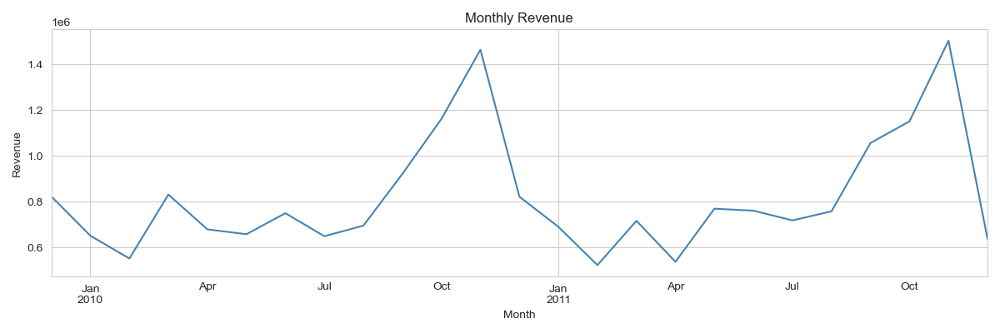
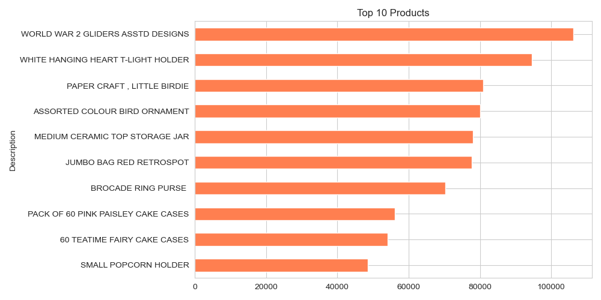
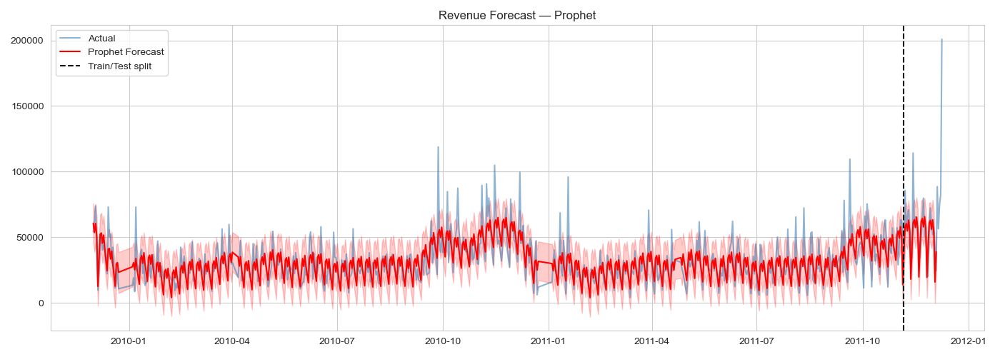

# RetailPulse - AI-Powered Customer Analytics & Demand Forecasting Platform

## Goal
Reduce stockouts and identify at-risk customers using retail sales data through machine learning.

## Dataset
**Online Retail II** (UCI Machine Learning Repository)
- 1,067,371 records
- Dec 2009 - Dec 2011
- UK online retailer (giftware)
- Location: `data/raw/retail-project-dataset.xlsx`

## Features

| Feature | Description |
|---------|-------------|
| Demand Forecasting | Prophet model with weekly seasonality |
| Customer Segmentation | RFM analysis + K-Means (4 segments) |
| Churn Prediction | Random Forest classifier (60-day definition) |
| Inventory Optimization | Reorder point recommendations |
| Interactive Dashboard | Streamlit, 4 tabs |
| Reports | CSV + PNG outputs in `reports/` |

## Results

### Customer Segments
| Segment | Customers | Description |
|---------|-----------|-------------|
| High-value | ~20% | Frequent buyers, high spend |
| Active | ~25% | Regular engagement |
| At-risk | ~34% | Used to buy, stopped |
| One-time buyer | ~21% | Low engagement |

**High-value customers generate ~74% of revenue.**

### Churn Prediction
- Definition: no purchase in 60 days
- Best model: Random Forest
- ROC-AUC: ~0.74

### Demand Forecast

| Model | MAE | RMSE |
|-------|-----|------|
| Naive | 18,868.84 | 31,722.28 |
| MovingAvg_7d | 22,605.94 | 35,989.10 |
| Prophet | 28,000.83 | 42,900.78 |

A simple Naive baseline performs best with ~2 years of data - a normal result.

### Inventory Optimization
22 of 50 top SKUs flagged for reorder.

## Charts





## Dashboard

Streamlit app with 4 tabs:
- **Forecast**: model metrics + Prophet chart
- **Segments**: pie chart + RFM scatter
- **Churn**: probability distribution + at-risk list
- **Inventory**: reorder recommendations

Run: `streamlit run app/dashboard.py`

## How to Run

1. **Install packages:**
   ```
   pip install -r requirements.txt
   ```

2. **Run the notebook:**
   Open `RetailPulse.ipynb` and run cells 1-20 in order

3. **Launch dashboard:**
   ```
   streamlit run app/dashboard.py
   ```

## Tech Stack
- **Language**: Python 3.10+
- **Data**: Pandas, NumPy
- **ML**: Scikit-learn, Prophet
- **Visualization**: Matplotlib, Seaborn, Plotly
- **Dashboard**: Streamlit

## Project Structure

```
retailpulse/
|-- data/
|   |-- raw/retail-project-dataset.xlsx
|   `-- processed/
|-- app/dashboard.py
|-- reports/
|-- requirements.txt
`-- README.md
```

## Limitations
- **Inventory**: current stock levels are assumed (dataset has no stock data)
- **Yearly seasonality**: limited with only 2 years of history
- **Prophet**: performs worse than Naive on this short dataset

## Author
Zidio Development - Data Science & Analytics Domain
March 2026
